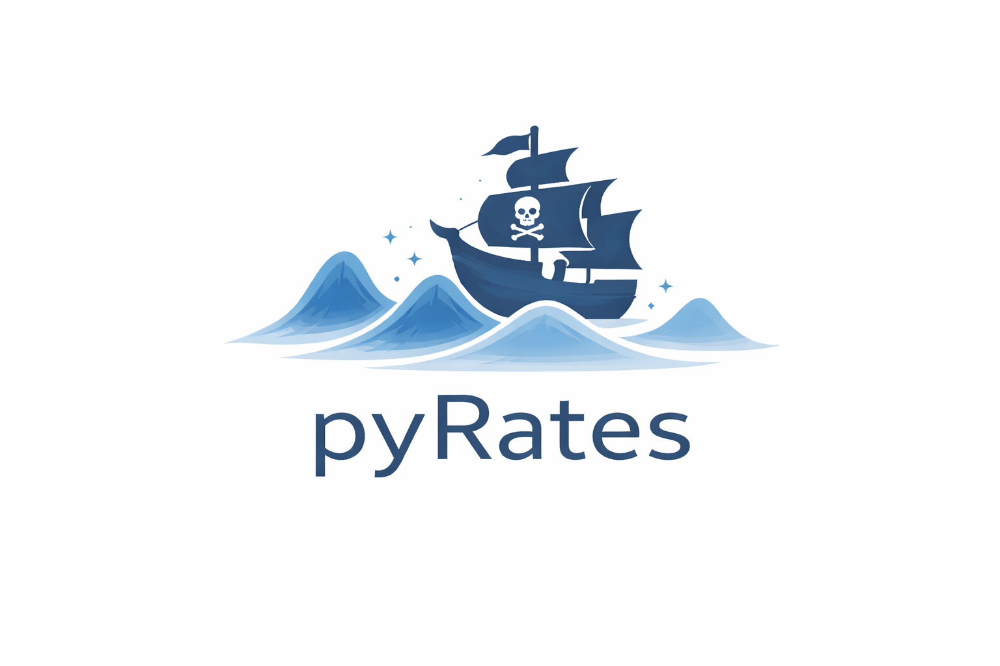

# pyRates

Framework for predicting properties of excited states.

<p align="center">
  
</p>

## Installation

### Requirements
- Linux
- Python >= 3.12
- [uv](https://github.com/astral-sh/uv)
- [CUDA Toolkit](https://developer.nvidia.com/cuda-toolkit) (optional, for GPU support)

### Setup

1. **Clone the repository:**
   ```bash
   git clone https://github.com/le-schlo/pyrates.git
   cd pyrates
   ```

2. **Set up environment and install dependencies:**
   Create a virtual environment and install dependencies from `pyproject.toml` using `uv`.
   ```bash
   uv venv
   source .venv/bin/activate
   uv pip install -e .
   ```

## Structure

- `pyrates/`: Core library.
  - `energy/`: Marcus theory and energy calculations.
  - `model/`: Neural network architectures.
    - `ffn/`: Feed-forward neural networks and Mixture Density Network (MDN).
    - `gnn/`: Graph encoders (D-MPNN, GAT, GIN, Transformer, MPNN, GPS).
    - `graph_mdn.py`: Main model, combines graph encoder with MDN.
    - `inference.py`: Inference routines.
    - `loss.py`: Loss functions for model training and evaluation.
    - `training.py`: Training routines, optimization, and model fitting.
  - `utilities/`: Utility functions.
    - `dataset/`: Data loading, graph construction, one-hot encoding.
    - `metrics/`: Metrics (Jaccard, Ranked Score).
    - `plotting/`: Visualization tools.

## Modules

### Graph Encoder (`pyrates.model.gnn`)
Supports various graph encoder architectures, selectable via the `encoder_type` parameter in `GraphMDN`:

- **D-MPNN (`dmpnn`)**: Directed Message Passing Neural Network.
- **GAT (`gat`)**: Graph Attention Network with edge features.
- **MPNN (`mpnn`)**: Standard Message Passing Neural Network with GRU.
- **GIN (`gin`)**: Graph Isomorphism Network (GINEConv).
- **Graph Transformer (`graph_transformer`)**:
  - Basic Graph Transformer (`base_transformer`): Base Transformer
  - Advanced Graph Transformer (`transformer` or `transformer_v2` (for legacy)): Improvements over base transformer like residual connections, normalization and FFN.
- **Graph GPS (`gps`)**: Graph GPS (General, Powerful, Scalable) combines local MPNN (GINEConv) with global attention mechanisms (Transformer/Performer). Utilizes Random Walk Structural Encoding (RWSE) for node-level positional information and Relative Random Walk Positional encoding (RRWP) for edge-level features, providing enhanced structural awareness for molecular property prediction.

### Mixture Density Network (`pyrates.model.ffn.mixture_density_network`)
The model outputs parameters for a Gaussian Mixture Model (means, standard deviations, weights):
- Predicts probability distributions for targets.
- Captures uncertainty and multimodal outputs.

### Multi-Task Learning and Task Weighting
The model supports both graph-level and node-level predictions simultaneously:
- **Graph-level tasks**: Predict molecular properties (e.g., energy, dipole moment).
- **Node-level tasks**: Predict atom-specific properties (e.g., partial charges, spin populations).
- **Task weighting**: When both task types are active, losses can be weighted using the `weight_graph_loss` parameter (range: 0-1). The node loss weight is automatically set as `1 - weight_graph_loss`, allowing flexible control over multi-task learning balance.

### Loss Function Strategies
MDN models are trained by minimizing the Negative Log-Likelihood (NLL) of the data given the model parameters using `mdn_loss`.

In addition to NLL, the following loss components are available to improve uncertainty estimation:
- **Calibration Loss (`calibration_loss`)**: Encourages correlation between predicted uncertainty and actual error. It minimizes the Mean Squared Error between the absolute error and the predicted uncertainty, ensuring the model predicts high uncertainty when the error is large and low uncertainty when accurate.
- **Sharpness Penalty (`sharpness_penalty`)**: An asymmetric penalty for overconfident predictions. It penalizes cases where the predicted uncertainty is smaller than the actual error, while underconfident (conservative) predictions are not penalized.

Different loss aggregation strategies are applied depending on the task configuration:
- **Graph-level only**: Mean loss over all graph samples using `mdn_loss`.
- **Node-level only**: Per-sample loss computed for each node, then averaged per graph using `scatter_mean`, followed by averaging over all graphs.
- **Dual-output (graph + node)**: Weighted combination of both loss types, allowing the model to optimize for multiple objectives simultaneously. Individual loss components (`loss_g`, `loss_n`) are tracked alongside the total weighted loss.

### Data Handling (`pyrates.utilities.dataset`)
- **Graph construction**: Converts SMILES strings to graph objects (`torch_geometric.data.Data`).
- **Featurization**: Atom features typically include atom type, degree, formal charge, hybridization, aromaticity, and chirality. Bond features include bond type, conjugation, ring membership, and stereochemistry. All features are encoded using one-hot or categorical encoding, enabling the models to process molecular graphs efficiently.
- **Positional encoding**: For GPS encoder, Random Walk Structural Encoding (RWSE) is added to nodes and Relative Random Walk Positional encoding (RRWP) is added to edges, capturing structural information beyond local connectivity patterns. These encodings can be configured via `positional_encoding_kwargs` with parameters like `walk_length` and `pe_dim`.
- **Normalization**: StandardScaler is used for target values to ensure stable training. For dual-output models with both graph and node tasks, separate scalers (`DualScaler`) handle graph-level and node-level targets independently.

### Visualization and Metrics
- Plotting modules for scatter plots and mode visualization.
- Metrics such as Jaccard and Ranked Score.
